# Task 3 and Task 4 Report: Session Security, Public Endpoint Shielding and Automated DAST

Repository: `rasxcho/Datheon_AppSec_Internship` (all data fictional; tested only on a local lab on `127.0.0.1`)
Evidence images are in `reports/screenshots/` and linked below.

---

## Task 3: Cryptographic session security

### 3.1 Problem
Storing a session token in `localStorage` or `sessionStorage` means any JavaScript running on the page can read it. A single cross-site scripting (XSS) flaw lets an attacker copy the token and reuse it from anywhere until it expires. Unlimited login attempts also allow automated password and ID guessing.

### 3.2 What was implemented

| Control | Implementation | Result |
|---|---|---|
| Signed token | HMAC-SHA256 JWT (`src/lib/jwt.ts`), algorithm pinned to HS256, constant-time signature comparison | Forged, edited and `alg:none` tokens are rejected |
| Token storage | `HttpOnly; SameSite=Lax; Path=/; Max-Age=900` cookie (`Secure` and the `__Host-` prefix in production) | JavaScript cannot read the credential; the login response body never contains the token |
| Expiry | 15-minute access token, checked on every request | A leaked token has a short life |
| Rotation | `POST /api/auth/refresh` issues a new token and revokes the old one | A stolen copy stops working after the next refresh |
| Logout | `POST /api/auth/logout` revokes the token on the server and clears the cookie | Replaying the old cookie value fails |
| Brute-force defence | Sliding-window limiter: 5 logins per minute per IP, 30 lookups per minute per IP, with `X-RateLimit-*` and `Retry-After` headers | The 6th attempt in a minute gets HTTP 429 |
| Password storage | scrypt with a per-password salt; a dummy hash for unknown users | No timing difference between "unknown user" and "wrong password" |
| Secrets | `JWT_SECRET` (32+ characters) required in production; random per-start key in development | The app refuses to start in production without a strong key |

### 3.3 Evidence

**Rotation** ([task3_rotation.png](screenshots/task3_rotation.png)): after a refresh, the cookie value changed. The old token returned `401 {"error":"Authentication required"}`, and the new token returned `200` with Alice's email, her role and an `expiresAt` exactly 15 minutes after the request.

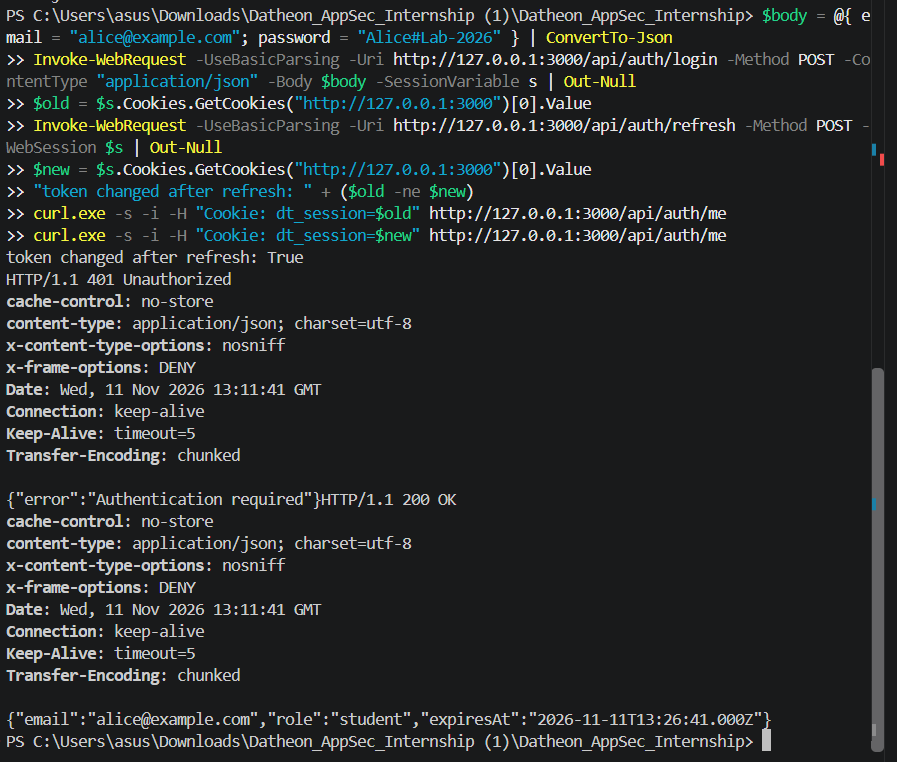

**Server-side logout** ([task3_logout_replay.png](screenshots/task3_logout_replay.png)): after logout, a request that still sends the old cookie value (`curl.exe ... -H "Cookie: dt_session=$new"`) returns `401 Unauthorized`. This shows revocation is enforced on the server and not only by the browser deleting the cookie.

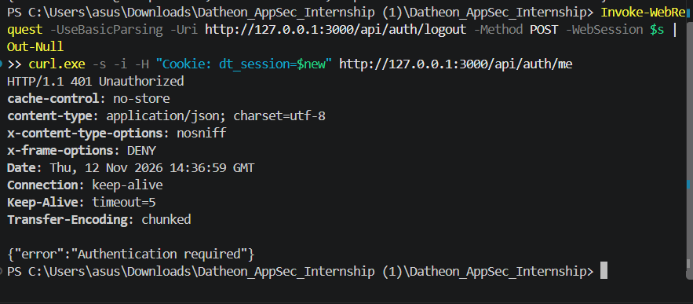

**Brute-force protection** ([task3_rate_limit.png](screenshots/task3_rate_limit.png)): seven wrong logins in a row. Attempts 1 to 5 return `401` with `X-RateLimit-Remaining` counting 4, 3, 2, 1, 0. Attempts 6 and 7 return `429` with `Retry-After: 60`.

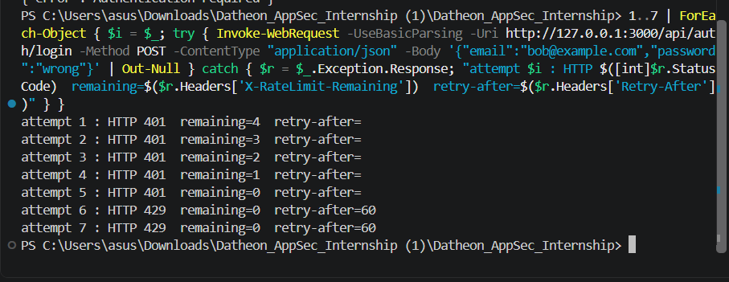

### 3.4 Known limits
- The rate limiter and revocation list are in memory, so they reset on restart and are not shared between instances. A production deployment should back both with Redis (for example Upstash): sorted sets for the sliding window, and keys with a TTL for revoked token ids.
- The client IP comes from the socket. Behind a reverse proxy, use the proxy's trusted forwarding header and strip any client-supplied copy.
- `SameSite=Lax` blocks cross-site POSTs in modern browsers, but stronger CSRF protection (an `Origin` check or CSRF tokens) would be a sensible addition.
- Per-IP limits do not stop distributed guessing; per-account throttling and alerting would be needed, designed carefully to avoid lockout abuse.

---

## Task 4: Public endpoint shielding, PII masking and automated DAST

### 4.1 Problem
Public lookup services (certificate verification, order tracking) must let anyone confirm a record without letting anyone discover personal data. They also need strict browser-facing headers, and those protections must not silently disappear in a later change.

### 4.2 What was implemented

**Public verification endpoint** `GET /api/public/verify?certId=DT-CERT-7F3K9Q2M` (`src/routes/publicVerify.ts`)
- Needs no login. Returns an allow-listed set of fields only: valid, certificate id, status, program, issue date, and masked holder, email and phone.
- Internal ids (`appId`) and the owner email are never returned, and the endpoint does not accept `DT-2026-001`-style application ids.
- Unknown and malformed ids return an identical `404` body, so the endpoint is not an existence oracle.
- A revoked certificate returns only `{ "valid": false, "certificateId": ..., "status": "revoked" }` with no holder details.
- Limited to 30 lookups per minute per IP, in a bucket separate from the authenticated lookup.

**Dynamic masking** (`src/lib/mask.ts`)

| Input | Output |
|---|---|
| `alice@example.com` | `a***e@example.com` |
| `+91 90000 00001` | `+** ***** ***01` (all digits hidden except the last two) |
| `Alice Kumar` | `A*** K***` |
| malformed email | `***` (fails closed) |

**Security headers** (`src/lib/securityHeaders.ts`), applied by the router to every response, including 401, 404, 405 and 500:

| Header | Purpose |
|---|---|
| `Content-Security-Policy: default-src 'none'; frame-ancestors 'none'; ...` | Nothing in an API response may load or execute content; blocks framing |
| `Strict-Transport-Security: max-age=63072000; includeSubDomains; preload` | Prevents downgrade to HTTP (ignored over plain HTTP, so harmless locally) |
| `X-Content-Type-Options: nosniff` | Blocks MIME sniffing |
| `X-Frame-Options: DENY` | Blocks clickjacking in older browsers |
| `Referrer-Policy: no-referrer` | Stops ids in URLs leaking through the Referer header |
| `Permissions-Policy`, `Cross-Origin-Resource-Policy`, `Cross-Origin-Opener-Policy` | Disable unused browser features and isolate cross-origin access |

The HTML dashboard page keeps its own nonce-based CSP; the router only fills in headers that are missing. `docs/next.config.example.ts` shows the same headers as a Next.js `headers()` configuration.

**CI pipeline** (`.github/workflows/security.yml`), run on every push and pull request:
1. **gitleaks** scans the full git history for committed secrets.
2. **Spectral** lints `openapi.yaml`; errors fail the build.
3. **Header gate** (`scripts/check_headers.sh`) starts the API and fails if a required header is missing from any of five endpoints (error responses included), or if `Server` or `X-Powered-By` leaks.
4. **OWASP ZAP API scan** runs against the live API using the OpenAPI file and uploads an HTML report as a build artifact.

The existing `ci.yml` continues to run typecheck and the full test suite.

### 4.3 Evidence

**Unit and integration tests**: 50 tests pass, including 17 for Task 4 ([task4_tests.png](screenshots/task4_tests.png)). They cover masking rules, "no raw PII anywhere in the payload", allow-listed fields, revoked records, identical 404s, throttling after 30 lookups, and headers on five different response types.

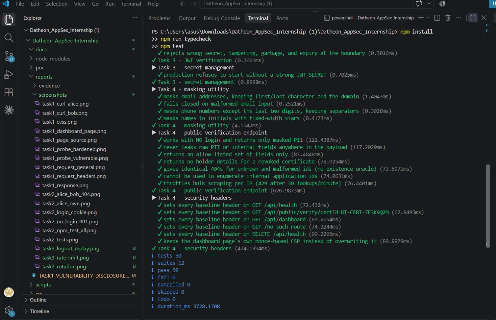

**Masked public response** ([task4_public_masked.png](screenshots/task4_public_masked.png)): holder `A*** K***`, email `a***e@example.com`, phone `+** ***** ***01`, with the security headers visible in the response.

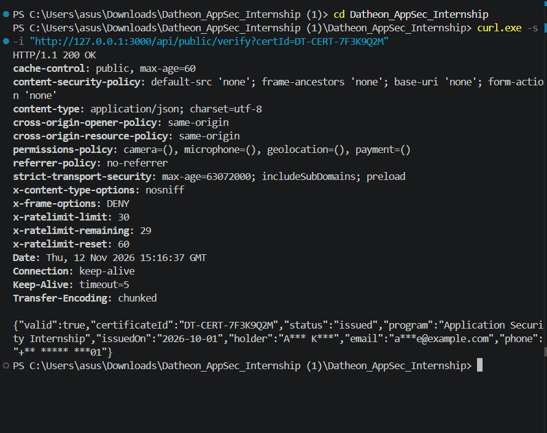

**Revoked certificate** ([task4_revoked.png](screenshots/task4_revoked.png)): only `valid:false` and `status:revoked`.

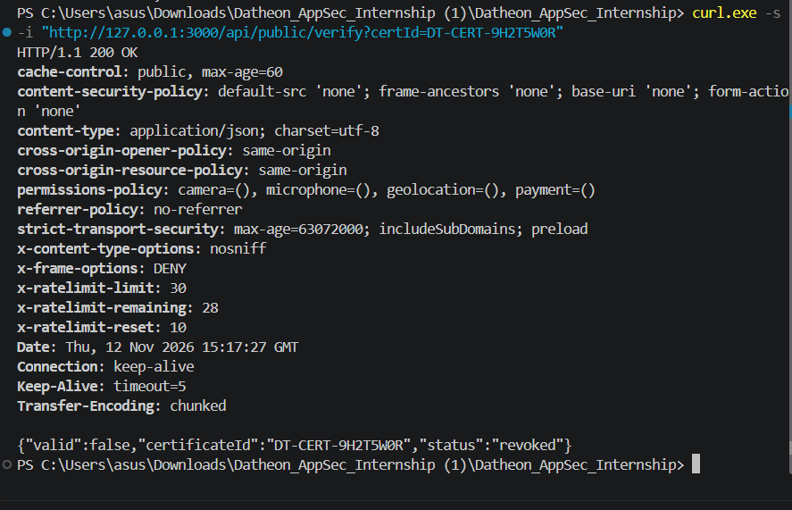

**Headers on error responses** ([task4_headers_on_404.png](screenshots/task4_headers_on_404.png)): a 404 for an unknown route still carries the full header set.

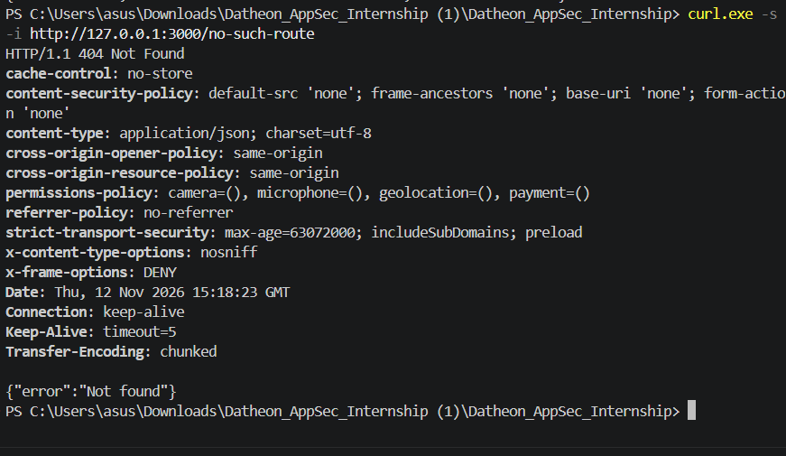

**Header gate, local run** ([task4_header_gate.png](screenshots/task4_header_gate.png)): `ok` for all five endpoints.

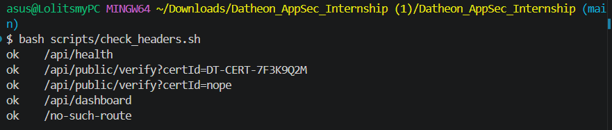

**Pipeline green** ([task4_actions_green.png](screenshots/task4_actions_green.png), [task4_security_jobs_green.png](screenshots/task4_security_jobs_green.png)): the `ci` and `security` workflows pass on `main`.

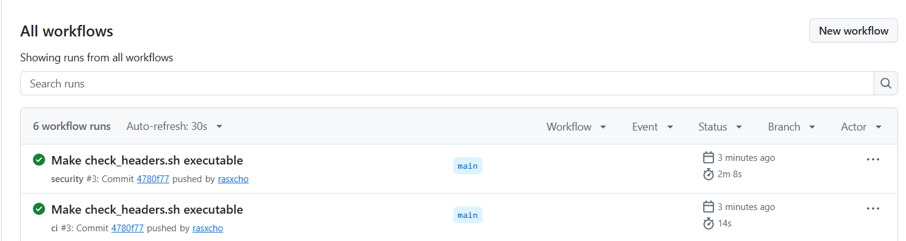
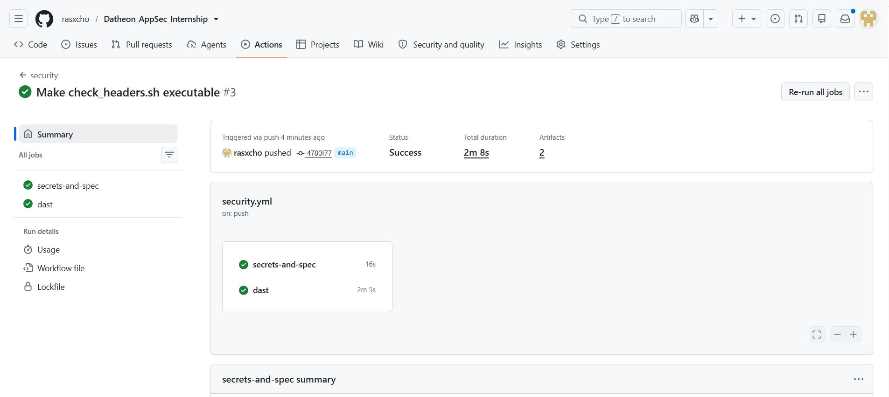

**Negative test: the gate fails when a header is removed** ([task4_negative_test_red.png](screenshots/task4_negative_test_red.png)). On a temporary branch, the `Strict-Transport-Security` line was deleted and pushed. Both `security` and `ci` went red. The header gate reported `missing: strict-transport-security` on all five endpoints, including `/no-such-route`, and exited with code 1. The branch was then deleted and was never merged.

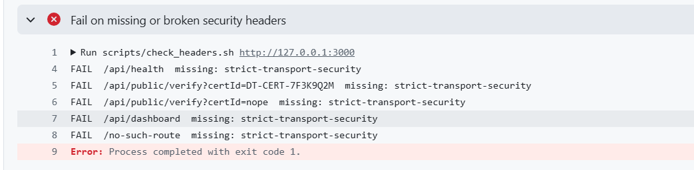

A first attempt removed `X-Frame-Options` instead, and the pipeline stayed green. That header is also set in the shared response helper (`src/lib/http.ts`), so removing it from one place left it in force on every response. This is defence in depth, and it shows why the test needed a header that is set in only one place. In a later cleanup, the duplicate definitions should be consolidated so the headers have a single source of truth.

### 4.4 Remediation checklist for a real deployment
- Terminate TLS first, then serve HSTS; add `preload` only when every subdomain supports HTTPS.
- If verifiers do not need the phone number, remove it from the public payload. Not returning a field is safer than masking it.
- Review the ZAP HTML report artifact on each run and tighten the rule overrides in `.zap/rules.tsv`. The workflow currently runs ZAP with `-I`, so warnings do not fail the build.
- Replace the in-memory limiter with Redis, and move certificates and applicant data to a real database that enforces the same allow-list.

### 4.5 Limitations
- The lab uses an in-memory data store with fictional records.
- Passing scans demonstrate absence of the checked issues, not absence of all vulnerabilities.
